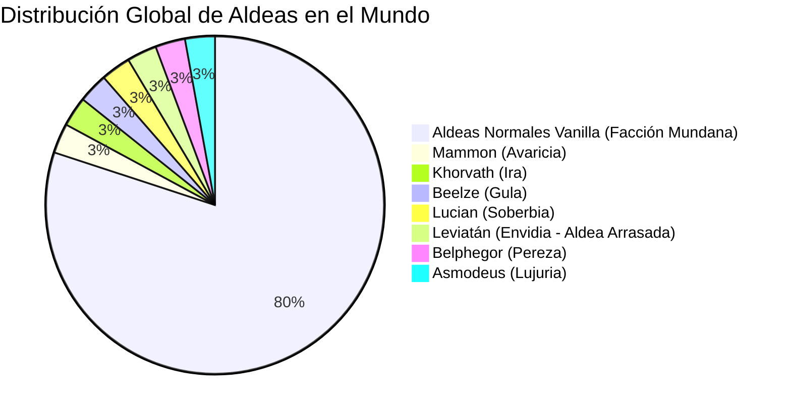
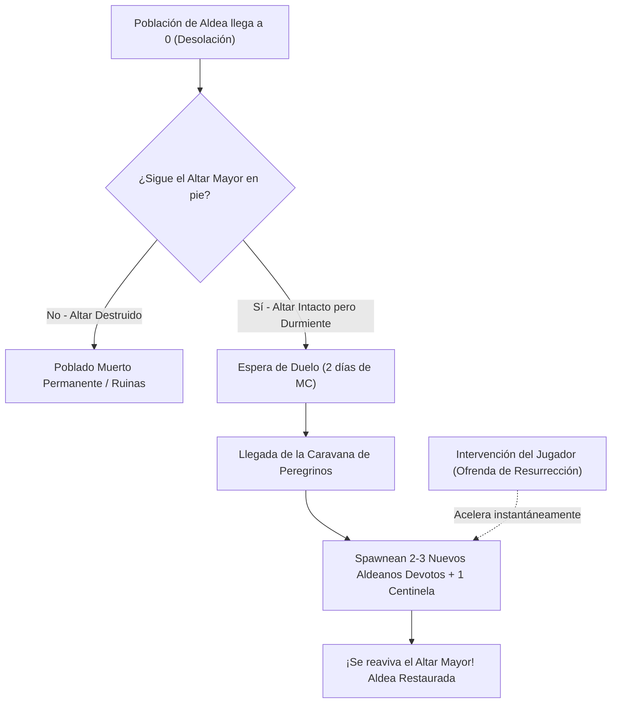
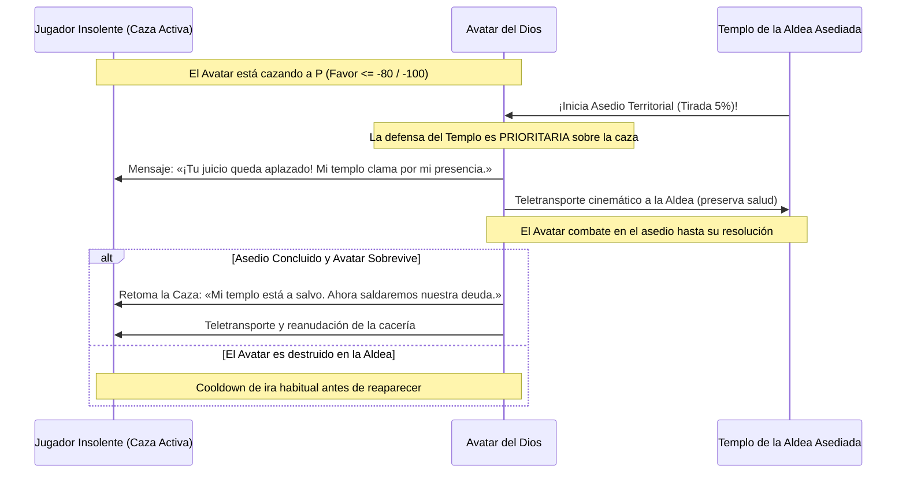

# 🏛️ Documento de Diseño: Aldeas de Facciones de Dioses (Game Design)

> [!NOTE]
> **Inspiración Mecánica y Conceptual**: El sistema de control territorial de aldeas, asedios y mercaderes de culto está inspirado conceptualmente en las mecánicas de aldeas de facción del repositorio de **[Vampirism (TeamLapen/Vampirism)](https://github.com/TeamLapen/Vampirism)**, adaptadas y rediseñadas desde cero para la mitología de los 7 Pecados Capitales y la arquitectura de NeoForge 26.3.

Este documento detalla todas las mecánicas de juego, economía, dinámicas de panteón, asedios, arquitectura y personalidades únicas para el sistema de **Aldeas Consagradas a los 7 Dioses del Pecado** en **Seven Deadly Gods**.

---

## 1. Visión General y Generación en el Mundo

Las aldeas vanilla de Minecraft tienen un **20% de probabilidad** (1 de cada 5 aldeas naturales generadas) de consagrarse a uno de los 7 Pecados Capitales. El 80% restante permanece como aldeas ordinarias de Minecraft sin culto alguno.



### 1.1 ¿Las Aldeas Normales (80%) Cuentan como Facción?
**Sí, pertenecen a la Facción Mundana / Sin Culto (`FACTION_NEUTRAL`).**
* **Naturaleza**: Son las aldeas vanilla tradicionales de Minecraft habitadas por campesinos, herreros y bibliotecarios protegidos por **Gólems de Hierro vanilla**.
* **Cómo las perciben los Dioses**: No las ven como iguales, sino como "tierra virgen de mortales ignorantes", "almas sin pastor" listas para ser convertidas, o "presas fáciles" para el expolio.

### 1.2 ¿Pueden las Aldeas Normales ser Atacadas por los Dioses?
**¡Rotundamente SÍ!** Las aldeas normales son vulnerables a las incursiones divinas de los 7 cultos. Esto genera eventos mundiales dinámicos con tres vertientes:

1. **Cruzadas de Conversión Forzosa**:
   * Una horda de acólitos desciende sobre la aldea neutral para someter a los aldeanos y forzar la consagración de un nuevo templo.
   * **El Choque**: Los **Gólems de Hierro vanilla** se baten en combate a muerte contra los **Acólitos alados**.
   * **Dilema del Jugador**:
     * *Si defiende a los campesinos*: Al repeler a los acólitos, los aldeanos le otorgan descuentos masivos de comercio (efecto *Hero of the Village* menor) y agradecimiento; pero el dios atacante se ofende perdiendo favor (**-8 a -15 de favor**).
     * *Si apoya a los acólitos*: Ayuda a someter a los gólems y a consagrar la aldea, ganando una gran cantidad de favor (**+15 a +20**) con el dios invasor.
2. **Incursiones de Saqueo Específicas por Pecado**:
   * **Mammon (Avaricia)**: Asalta para recaudar "tributos atrasados"; los acólitos saquean los cofres de los herreros y exigen esmeraldas.
   * **Beelze (Gula)**: Caza y masacra el ganado de los corrales y devora los campos de trigo y zanahorias campesinas para su festín.
   * **Khorvath (Ira)**: Desafía y destruye a los Gólems de Hierro en sangrientos duelos públicos, buscando batalla pura.
   * **Leviatán (Envidia)**: Asalta las aldeas prósperas por puro resentimiento; quema casas y busca reducirlas a cenizas y ruinas.
   * **Asmodeus (Lujuria)**: Encanta a los aldeanos con perfumes hipnóticos para vaciar sus recursos.
3. **Mecánica de Conversión Dinámica (De Normal a Devota)**:
   * Si una incursión de conversión triunfa, o si el jugador levanta y consagra un **Altar Mayor** en el centro de una aldea normal, ¡la aldea pasa de ser neutral a convertirse formalmente en una **Aldea Consagrada**! Los aldeanos visten bandas ceremoniales y aparecen acólitos centinelas protectores.

---

## 2. El Altar de la Aldea vs El Altar del Jugador

Una duda fundamental de diseño es: **¿Debe el altar de una aldea ser idéntico al que craftea el jugador en su base?**

### 2.1 La Decisión: "El Altar Mayor Consagrado" (*Village Hearth Altar*)
El altar del jugador y el altar del pueblo comparten la misma esencia mística, pero el de la aldea es un **Altar Mayor Consagrado**:

* **Estructura Monumental**: No es solo un bloque suelto en el suelo; se asienta sobre un zócalo ceremonial de piedra tallada y oro/obsidiana con llamas eternas o partículas celestiales según el dios.
* **Corazón Territorial (`Village Hearth`)**: El Altar Mayor es el ancla que emite el radio de influencia sagrada (48 bloques) y coordina la memoria de la aldea.
* **Protección Sagrada**: No puede ser picado de un solo golpe por un jugador oportunista mientras los defensores vivan; posee una **Dureza Sagrada** que alerta inmediatamente a todos los acólitos si alguien intenta dañarlo.
* **Cofre de Diezmos Comunal**: Junto al altar se halla el arcón donde los aldeanos devotos depositan tributos diarios.
* **Bono de Devoción (+20%)**: Cualquier ritual realizado por el jugador en un Altar Mayor consagrado otorga un **20% más de favor** que si se realiza en un altar doméstico.

---

## 3. Dinámica del Panteón: Devoción Múltiple y Sus Límites

¿Puede un jugador ser devoto de varios dioses a la vez?

### 3.1 Niveles de Devoción en el Panteón
Minecraft permite explorar múltiples caminos, pero los 7 Pecados son celosos y contradictorios por naturaleza:

1. **Devoción Menor / Simpatía (`Favor entre 0 y +39`)**:
   * El jugador puede mantener simpatía con **2 o 3 dioses simultáneamente**, siempre que no realice actos que enfurezcan directamente a sus contrapartes (ej: disfrutar de banquetes para *Beelze* sin violar las leyes de *Mammon*).
   * Puede comerciar pacíficamente en las aldeas de todos los dioses con los que tenga favor positivo.
2. **Pacto de Campeón (`Favor >= +40`)**:
   * A partir de este umbral, el jugador ya no es un mero simpatizante: es un **Discípulo Formal**.
   * **Celos Divinos Inevitables**:
     * *Leviatán (Envidia)* castiga al jugador con ira automática si este supera los **+20 de favor** con cualquier otro dios.
     * Si intentas alcanzar el rango de Campeón (+50 o más) con un segundo dios rival (ej: *Khorvath* e *Ira* vs *Mammon* y *Avaricia*), el dios anterior interpretará la ofrenda como una traición y comenzará a drenar su favor.
3. **El Dios Patrón Primario**:
   * Se define como el dios con el que el jugador posea el **mayor nivel de favor absoluto** (siempre que sea `favor >= +40`). Este dios es quien acudirá en su auxilio y en cuyo nombre se librarán las guerras de clanes.

---

## 4. Iniciación de Ataques por Parte del Jugador

El jugador no es un mero espectador: puede liderar asedios a las aldeas de los dioses.

### 4.1 ¿Cómo inicia un ataque el jugador?
Existen dos formas de iniciar una invasión contra una aldea consagrada:

1. **Ataque Físico / Profanación Directa**:
   * Si el jugador ataca a un aldeano devoto, hiere a un acólito centinela o golpea el Altar Mayor, sonará la campana de rebato y la aldea entrará inmediatamente en estado de **Defensa Territorial**.
2. **El Cuerno de Asedio Divino (`Divine War Horn`) o Estandarte de Guerra**:
   * Un ítem ritual que el jugador puede craftear o comerciar con su dios patrón.
   * Al situarse a las afueras de la aldea enemiga (entre 32 y 64 bloques del templo) y hacer sonar el cuerno:
     * El cielo cambia de tonalidad adoptando el color del dios del jugador.
     * ¡Un escuadrón de **Acólitos Invasores leales al jugador** desciende de los cielos para apoyarlo en la conquista!

### 4.2 ¿Qué dios inicia el ataque?
* Si el jugador usa el cuerno o estandarte de guerra, el ataque se lanza formalmente en nombre de su **Dios Patrón Primario**.
* Si el jugador no tiene ningún dios con `favor >= +40`, ataca como un **Hereje Renegado Sin Dios** (los acólitos invasores no aparecerán, peleará en solitario y todos los dioses verán su acto como pura barbarie).

### 4.3 ¿Puede el jugador atacar aldeas de dioses con los que se lleva bien?
**¡SÍ! La libertad en Minecraft es sagrada.** Un jugador puede decidir traicionar a Mammon para saquear la cámara del tesoro de su propio templo.

#### Consecuencias de la Alta Traición:
* **Penalización Catastrófica Inmediata**: Atacar una aldea donde tenías `Favor >= 0` provoca una caída instantánea de **`-60 puntos de favor`**, convirtiéndote en Hereje en el acto.
* **Furia Divina y Cólera de los Acólitos**: Todos los mercaderes y guardias que antes te saludaban desenfundan sus armas con ojos encendidos.
* **Respuesta Dramática con IA (Gemini)**: El Dios envía un mensaje de odio visceral por el chat:
  > *«¡Miserable traidor! Comiste de mi mano, recibiste mis bendiciones y ahora bañas mi templo en sangre. ¡No habrá rincón en este mundo donde mi cólera no te alcance!»*

---

## 5. Incursiones Autónomas del Mundo (`Guerras Santas Espontáneas`)

¿Cuándo y bajo qué condiciones ocurren los ataques entre cultos sin intervención del jugador?

### 5.1 Condiciones Orgánicas de Aparición
Para no arruinar la experiencia del jugador ni destruir aldeas en chunks remotos sin que nadie lo sepa:
* **Presencia de Jugador Requerida**: La invasión **solo se activa** si hay al menos un jugador en un radio de **80 bloques** de la aldea (o en la propia aldea).
* **Cooldown de Aldea**: Cada aldea tiene un periodo de gracia obligatorio de mínimo **3 a 5 días de Minecraft (72,000 a 120,000 ticks)** tras un asedio antes de poder sufrir otro.
* **Probabilidad Diaria**: Al inicio de cada noche, si las condiciones se cumplen, hay un **12% de probabilidad** de que una patrulla de guerra enemiga localice el templo.
* **Señales Previas de Advertencia (60 segundos antes)**:
  * El cielo sobre la aldea se tiñe con la niebla del dios invasor.
  * Se escuchan cuernos de guerra lejanos y truenos sordos.
  * El chat notifica a todos los jugadores cercanos con las coordenadas del evento.

---

## 6. Habitantes de la Aldea: Milicia vs Civiles

Para que la aldea se sienta viva, existe una estricta división social:

```
                          HABITANTES DE LA ALDEA DEVOTA
                                       │
        ┌──────────────────────────────┴──────────────────────────────┐
        ▼                                                             ▼
[ ACÓLITOS GUARDIANES / CENTINELAS ]                    [ ALDEANOS DEVOTOS / CIVILES ]
- Portan armaduras sagradas y alas                      - Visten bandas del color del culto
- Patrullan el templo y las entradas                    - Realizan profesiones modificadas
- Atacan a muerte si Favor <= -40                       - Comercian si Favor >= 0
- Defienden a los aldeanos de asaltos                   - Huyen a sus casas si suena la alarma
```

### 6.1 Acólitos Guardianes Armados (`GodAcolyteEntity`)
* En cada aldea consagrada habitan entre **3 y 6 Acólitos Centinelas permanentes**.
* **Equipamiento temático completo** según su dios (espadas de fuego para Khorvath, armadura dorada y ballestas con virotes brillantes para Mammon, capas oscuras para Leviatán).
* Cuentan con vuelo pasivo, caída lenta y resistencia reforzada.
* No desaparecen por tiempo (`lifeTicks` desactivado en centinelas de aldea).

### 6.2 Aldeanos Devotos y Fanáticos
* Conservan el comportamiento civil de Minecraft (dormir, cosechar, hablar en corrillos), pero adaptado a la estética de su fe.
* Si el jugador tiene `Favor >= 0`, abren su catálogo de **Comercio Divino**.
* Si el jugador tiene `-39 <= Favor < 0`, niegan con la cabeza (*Villager No*) y le exigen arrepentirse en el altar.
* Si el jugador tiene `Favor <= -40`, huyen aterrorizados a sus casas gritando advertencias.

---

### 6.3 Mortalidad durante los Asedios: ¿Mueren Aldeanos?
**Sí, los aldeanos civiles pueden morir durante los combates.**
* **Comportamiento Defensivo**: Al sonar la campana de rebato del templo, los aldeanos corren a encerrarse en sus casas con cerrojos. Los **Acólitos Centinelas** y los **Gólems de Hierro** forman la primera línea defensiva y concentran la hostilidad de los invasores.
* **Causas de Muerte Civil**:
  * Si los acólitos guardianes caen abatidos, los invasores pueden forzar las puertas de las casas para masacrar o expulsar a los infieles (especialmente las hordas de *Khorvath* y *Leviatán*).
  * Daños colaterales: fuegos provocados, rayos divinos o habilidades de área de los Avatares pueden diezmar a la población civil.

---

### 6.4 ¿Qué Ocurre si Mueren Todos los Aldeanos? (Estado de Aldea Fantasma)
Si la población de aldeanos llega a **0**:
1. **Estado "Templo Desolado / Aldea Durmiente"**:
   * En `GodVillageSavedData`, el poblado pasa al estado `DESOLATED`.
   * El fuego sagrado del Altar Mayor se apaga, emitiendo una columna de humo negro y chispas débiles.
   * La campana deja de repicar y cesan las ofertas de comercio.
2. **Reacción del Dios Patrón**:
   * El Dios lamenta la pérdida o desprecia la debilidad de sus siervos caídos, enviando un mensaje fúnebre por el chat:
     > *«Las campanas enmudecen y la sangre de mis fieles empapa la tierra. Mi templo duerme hasta que nuevas almas respondan a mi llamado.»*
3. **Resolución de la Invasión**:
   * Si los invasores sobreviven y vencen:
     * Si el asalto era de *Leviatán (Envidia)*: la aldea queda convertida en ruinas quemadas.
     * Si era de otro dios con intención de conquista: los invasores profanan el altar y lo reclaman para su propia deidad.

---

### 6.5 Mecánicas de Reajuste y Repoblación Divina
A diferencia del Minecraft vanilla (donde una aldea con 0 aldeanos queda muerta para siempre a menos que cures aldeanos zombi), los 7 Dioses disponen de **mecánicas místicas de repoblación automática y asistida**:



1. **La Caravana de Peregrinos del Culto (*Pilgrim Resupply*)**:
   * Si el Altar Mayor no ha sido destruido, tras un periodo de duelo de **2 días de Minecraft (48,000 ticks)**, el dios emite un llamado espiritual a través del mundo.
   * Aparece una **Caravana de Peregrinos**: se generan en los límites exteriores de la aldea **2 a 3 nuevos aldeanos devotos** y **1 acólito centinela** que caminan solemnemente hacia el centro, encienden de nuevo el fuego del altar y ocupan las casas vacías.
2. **Milagro de Restauración por el Jugador**:
   * Un jugador devoto (`Favor >= +30`) puede revitalizar inmediatamente una aldea desolada realizando una **Ofrenda de Restauración** sobre el altar durmiente (ej: *Lingote de Oro* para Mammon, *Pan Dorado/Pastel* para Beelze, *Lágrima de Ghast* para Asmodeus).
   * Al recibir la ofrenda, el altar libera una onda dorada de choque que reaviva las campanas y convoca instantáneamente a los nuevos peregrinos.
3. **Peculiaridades de Repoblación por Dios**:
   * **Asmodeus (Lujuria)**: Si sobrevive al menos 1 o 2 aldeanos, las feromonas sagradas aumentan la velocidad de reproducción en un **+300% sin requerir comida**, recuperando la población completa en cuestión de minutos.
   * **Belphegor (Pereza)**: En lugar de apresurarse a buscar humanos, el dios despierta automáticamente a **2 Gólems de Hierro guardianes** para vigilar y barrer la aldea vacía hasta que los peregrinos lleguen a su ritmo.


---

## 7. El Caso Especial de Leviatán: La Aldea Arrasada

El Dios de la Envidia desprecia profundamente la comunidad, la paz campesina y la prosperidad compartida. Por tanto, **las aldeas de Leviatán no son aldeas normales**:

### 7.1 Generación de la "Aldea en Ruinas / Asentamiento de Parias"
Cuando el generador del 20% consagra una aldea a **Leviatán**, la estructura generada es un **Pueblo Arrasado**:
* **Arquitectura Decadente**: Techos derruidos, vigas de madera quemada, adoquines cubiertos de musgo y telarañas.
* **El Altar Oculto en las Catacumbas**: El Altar de la Envidia no está al aire libre; se oculta en una cripta o sótano bajo la plaza destrozada.
* **Población Marginal**: Los aldeanos visten harapos verdes y oscuros; no cultivan la tierra alegremente, sino que comercian con **objetos robados** de otras aldeas y reliquias saqueadas a precios sospechosamente bajos.
* **Rol en los Asedios**: Los cultistas de Leviatán son la facción que con mayor frecuencia lanza ataques contra las ricas aldeas de Mammon o las majestuosas catedrales de Lucian. Si los invasores de Leviatán destruyen una aldea enemiga, **la reducen a cenizas y escombros**, convirtiéndola en una nueva aldea arrasada.

---

## 8. Atmósfera y Detalles Únicos para Cada uno de los 7 Cultos

Cada aldea debe ser instantáneamente reconocible a simple vista por su atmósfera, arquitectura y comportamiento de sus gentes:

```
+----------------------------------------------------------------------------------------------------------+
|                              IDENTIDAD VISUAL Y TEMÁTICA DE CADA ALDEA                                   |
+-------------------+--------------------------------------------------------------------------------------+
| Dios del Pecado   | Rasgos Distintivos, Arquitectura y Comportamiento Social                             |
+-------------------+--------------------------------------------------------------------------------------+
| 1. Mammon         | • Gran Bóveda Central blindada con rejas de hierro y bloques de oro junto al altar.  |
| (Avaricia)        | • Farolas con linternas de oro y adoquines pulidos con vetas áureas.                 |
|                   | • Aldeanos vestidos con trajes de mercader opulento; te exigen "peaje" de 1 pepita  |
|                   |   de oro si quieres abrir cofres en el pueblo.                                       |
+-------------------+--------------------------------------------------------------------------------------+
| 2. Khorvath       | • Fosos de gladiadores y cuadriláteros de arena en la plaza central.                 |
| (Ira)             | • Antorchas de fuego de alma, dianas de tiro y calaveras ensartadas en picas de hierro|
|                   | • No hay cultivos delicados; hay ahumadores de carne y acólitos afilando espadas.    |
|                   | • Los aldeanos lucen cicatrices de combate y hablan con voces roncas y desafiantes.  |
+-------------------+--------------------------------------------------------------------------------------+
| 3. Beelze         | • Mesas de banquete corridas en las calles repletas de tartas, panes y carnes asadas.|
| (Gula)            | • Granjas gigantescas con vacas y cerdos sobrealimentados que no paran de comer.     |
|                   | • Hornos y ahumadores masivos siempre encendidos emitiendo humo constante.           |
|                   | • Aldeanos carniceros y panaderos con delantales manchados; comida gratis en cofres. |
+-------------------+--------------------------------------------------------------------------------------+
| 4. Lucian         | • Majestuosa Catedral central de Cuarzo Liso, Mármol y Ladrillos de Piedra Pulida.   |
| (Soberbia)        | • Estandartes dorados de gran altura y torres con remates afilados.                  |
|                   | • Estatua monumental de alabanza al dios en la plaza.                                |
|                   | • Los aldeanos caminan erguidos y se niegan a hablarte si no vas con armadura noble  |
|                   |   o si no te agachas (Shift) como muestra de sumisión respetuosa.                    |
+-------------------+--------------------------------------------------------------------------------------+
| 5. Leviatán       | • Aldea Arrasada: casas a medio quemar, sótanos secretos, telarañas y lodo.          |
| (Envidia)         | • Altar en catacumbas sumergidas rodeado de agua estancada y prismarina oscura.      |
|                   | • Parias recelosos que te observan desde las esquinas con dagas ocultas.             |
|                   | • Mercado negro con mercancía saqueada de otras aldeas y ganzúas de cerrajero.       |
+-------------------+--------------------------------------------------------------------------------------+
| 6. Belphegor      | • ¡Casi todos los aldeanos son "Holgazanes" (Nitwits con túnica verde)!              |
| (Pereza)          | • Duermen hasta tarde (incluso al mediodía) en hamacas de lana colgadas de los techos|
|                   | • Huertos descuidados con malas hierbas; 1 o 2 Gólems de Hierro lentos hacen el      |
|                   |   trabajo pesado mientras los habitantes descansan tumbados mirando el cielo.        |
|                   | • Camas en plena calle para que cualquiera pueda echarse una siesta en cualquier     |
|                   |   momento; si despiertas a un aldeano bruscamente, se enfada.                        |
+-------------------+--------------------------------------------------------------------------------------+
| 7. Asmodeus       | • Jardines exhuberantes rebosantes de rosas rojas, flores de cerezo y fuentes.       |
| (Lujuria)         | • Música suave y melodiosa emanando permanentemente de cajas de música ocultas.      |
|                   | • Densidad animal enorme: ovejas, conejos y caballos reproduciéndose continuamente   |
|                   |   debido a las feromonas místicas en el aire.                                        |
|                   | • Aldeanos con túnicas de terciopelo magenta perfumadas que lanzan corazones al      |
|                   |   saludar a los devotos.                                                             |
+-------------------+--------------------------------------------------------------------------------------+
```

---

## 9. Catálogo Completo de Comercio Divino por Culto

Cuando un jugador con `Favor >= 0` interactúa con los acólitos o mercaderes devotos, accede a las siguientes ofertas exclusivas:

### 9.1 Mammon (Avaricia) - *El Banquero Celestial*
* *Nivel 1*: 8 Lingotes de Oro ➔ 5 Esmeraldas.
* *Nivel 2*: 32 Esmeraldas ➔ 4 Diamantes refinados.
* *Nivel 3*: *Bolsa de Monedas Bendita* ➔ Otorga *Haste II* y *Luck II* al minar bajo tierra (duración 12 min).
* *Nivel 4*: *Mapa de Bóveda Escondida* ➔ Conduce a una cámara subterránea con cofres repletos de oro y gemas.
* *Nivel 5*: *Libro Encantado: Fortuna IV* (Permite picar minerales con rendimientos imposibles en vanilla).

### 9.2 Khorvath (Ira) - *El Maestro Armero de Sangre*
* *Nivel 1*: 1 Calavera de Esqueleto + 5 Hierro ➔ Espada Pesada de Acólito (Daño +8.5, Velocidad 1.4).
* *Nivel 2*: 15 Esmeraldas ➔ Frasco de Furia Sangrienta (*Fuerza II* y *Velocidad II* durante 4 minutos).
* *Nivel 3*: *Piedra de Afilado Sanguínea* ➔ Repara armas de mano consumiendo 2 corazones de vida en vez de XP.
* *Nivel 4*: *Hacha de Guerra del Carnicero* ➔ Aplica efecto desangrado (*Bleed*) que ignora la armadura del rival.
* *Nivel 5*: *Libro Encantado: Filo VI (Sharpness VI)*.

### 9.3 Beelze (Gula) - *El Banquete Inagotable*
* *Nivel 1*: 4 Esmeraldas ➔ 12 Zanahorias Doradas de Cosecha Sagrada.
* *Nivel 2*: 8 Esmeraldas ➔ *Pastel Inagotable de Beelze* (Al comerlo en el suelo, se regenera cada amanecer).
* *Nivel 3*: *Néctar de Ambrosía* ➔ Cura cualquier debuff negativo y añade 4 corazones de absorción dorada.
* *Nivel 4*: *Cuchillo de Carnicero Divino* ➔ Triplica la carne obtenida de cualquier animal abatido.
* *Nivel 5*: *Sopa del Glotón* ➔ Rellena instantáneamente la barra de comida y concede *Saturación Infinita* por 10 min.

### 9.4 Lucian (Soberbia) - *El Emporio de la Majestad*
* *Nivel 1*: 10 Esmeraldas ➔ 16 Ladrillos de Cuarzo Imperial Brillante.
* *Nivel 2*: 24 Esmeraldas ➔ *Diseño de Forja Imperial (Armor Trim: Lucian's Crest)*.
* *Nivel 3*: *Capa de Majestad* ➔ Concede un 20% de resistencia al daño si ningún otro jugador está en tu grupo.
* *Nivel 4*: *Espejo del Amor Propio* ➔ Disipa ilusiones y revela entidades invisibles en 32 bloques.
* *Nivel 5*: *Tótem de Soberbia Inquebrantable* ➔ Al activarse tras un golpe fatal, libera una onda expansiva de rayo que desintegra a los atacantes cercanos.

### 9.5 Leviatán (Envidia) - *El Mercado Negro de Sombras*
* *Nivel 1*: 6 Carne Podrida + 2 Esmeraldas ➔ Ganzúa de Infiltrador (Abre cofres protegidos sin hacer ruido).
* *Nivel 2*: 12 Esmeraldas ➔ *Loot Bag Saqueada* (Contiene botín aleatorio robado a aldeas de otros dioses).
* *Nivel 3*: *Talismán del Ojo Codicioso* ➔ Permite ver la silueta brillante de los cofres con botín a través de las paredes.
* *Nivel 4*: *Poción de Sombra Absoluta* ➔ Invisibilidad completa que no revela tu armadura ni los ítems que portes.
* *Nivel 5*: *Daga Envenenada de Leviatán* ➔ Paraliza a los enemigos golpeados durante 6 segundos.

### 9.6 Belphegor (Pereza) - *El Taller de la Inercia*
* *Nivel 1*: 5 Lana ➔ *Almohada de Ensueño* (Permite dormir en cualquier momento del día o durante tormentas).
* *Nivel 2*: 16 Esmeraldas ➔ *Amuleto de Levitación Pasiva* (Evita tener que saltar bloques de 1 altura al andar).
* *Nivel 3*: *Cama de Rebote Terapéutico* ➔ Al dormir en ella, cura todas las heridas y duplica la regeneración.
* *Nivel 4*: *Embudo Imantado* ➔ Absorbe automáticamente todos los drops caídos al suelo en un radio de 10 bloques hacia el inventario del jugador.
* *Nivel 5*: *Núcleo de Gólem Perezoso* ➔ Spawnea un Gólem Autómata que cosecha y replanta automáticamente los huertos de tu base sin que tengas que trabajar.

### 9.7 Asmodeus (Lujuria) - *El Gabinete del Deseo*
* *Nivel 1*: 3 Rosas + 2 Esmeraldas ➔ *Frasco de Feromonas de Cría* (Hace procrear a todos los animales cercanos a la vez).
* *Nivel 2*: 14 Esmeraldas ➔ *Perfumero de Encanto* (Pacífica temporalmente a creepers y esqueletos para que no ataquen).
* *Nivel 3*: *Lazo de Afinidad* ➔ Vincula a dos criaturas o jugadores para compartir regeneración de salud.
* *Nivel 4*: *Semilla de Flor de Cerezo Sagrada* ➔ Al plantarla, hace crecer un cerezo místico que suelta gotas curativas.
* *Nivel 5*: *Anillo de Pasión Cautivadora* ➔ Concede un 25% de probabilidad de que los ataques enemigos fallen embelesados por tu presencia.

---

## 10. Clímax del 5%: Choque de Dioses durante los Asedios

Durante cualquier asedio a una aldea consagrada (sea provocado por el jugador o por una invasión espontánea), la tirada del **5% de Manifestación Divina** desencadena el evento más espectacular del mod:

1. **Oscurecimiento de la Atmósfera**: El cielo se tiñe de tormenta cósmica con nubes arremolinadas sobre el Altar Mayor.
2. **Descenso del Avatar**:
   * Si desciende el **Avatar Defensor**: Aterriza en el altar con un trueno titánico, proyectando un escudo de luz y masacrando a los invasores rivales.
   * Si desciende el **Avatar Atacante**: Cae como un meteoro destruyendo las defensas exteriores para profanar el templo.
   * **El Gran Choque (15% del 5%)**: ¡Ambos Avatares colisionan en la plaza de la aldea en un duelo de proporciones épicas!
3. **Botín y Recompensa Legendaria**:
   * Los jugadores que participen en la defensa y salven la aldea reciben **+25 de Favor**, el título de *Salvador del Templo* y reliquias divinas exclusivas del dios protector.

---

## 11. Regla de Avatar Único y Prioridad sobre los Eventos de Caza

El sistema respeta estrictamente la regla cardinal del mod: **Solo puede existir un único Avatar físico activo de cada Dios en todo el servidor**.

### 11.1 Prioridad Absoluta del Asedio Territorial sobre la Caza Individual
Si la tirada del 5% selecciona a un Dios que **ya tiene un Avatar activo en el servidor**:



1. **¿Qué ocurre si el Avatar estaba en una Caza de Ira (`isWrathHunter()`)?**:
   * La supervivencia o conquista del **Templo del Culto** es una prioridad cósmica infinitamente mayor que castigar a un simple mortal insolente.
   * El Avatar **interrumpe inmediatamente la caza** y ejecuta una escena de salida cinemática frente al jugador cazado (relámpagos oscuros, vórtice de fuego y sonido de trueno).
   * Se envía un mensaje solemne al jugador insolente:
     > *«¡Mortal insolente! Tu juicio queda aplazado: mi templo sagrado clama por mi presencia divina. ¡Considera este día un préstamo de vida!»*
   * El Avatar se **teletransporta a la aldea asediada**, preservando su salud actual, y asume el rol de defensor o atacante en el asedio.
2. **Mecánica de Caza Pospuesta (*Postponed Wrath Hunt*)**:
   * El sistema almacena el UUID del jugador cuya caza fue interrumpida (`postponedWrathHuntPlayerUuid`).
   * **Reanudación de la Caza**:
     * En cuanto el asedio de la aldea concluye (invasores eliminados o templo conquistado), si el Avatar sobrevive y el jugador insolente sigue en línea:
     * El Avatar no se desvanece pasivamente: ¡se teletransporta de vuelta a las inmediaciones del jugador insolente para **retomar la caza** con un rugido triunfal!
       > *«Mi templo sagrado está a salvo. Ahora... volvamos a nuestra deuda pendiente, mortal.»*
3. **¿Qué ocurre si el Avatar era un Avatar Campeón Invocado?**:
   * Si el Avatar estaba acompañando a su fiel campeón (`favor >= +85`) en otra zona del mundo, el Dios le habla telepáticamente:
     > *«Mi fiel campeón, las campanas de mi templo tañen en agonía. Debo acudir a la batalla sagrada.»*
   * El Avatar se desplaza a la aldea para liderar el combate. Al finalizar, regresa con su campeón o se desvanece bendiciéndolo tras agotar su tiempo de manifestación.

---

## 12. Filosofía de Balance, Estados del Mundo y Experiencia de Jugador

Para garantizar que el mod se sienta inmersivo sin volverse frustrante o destructivo para partidas de supervivencia de larga duración, el ciclo de vida de las aldeas sigue esta máquina de estados:

```
                                  CICLO DE VIDA DE UNA ALDEA
                                              │
                    ┌─────────────────────────┴─────────────────────────┐
                    ▼                                                   ▼
         [ 80% ALDEA MUNDANA ]                                [ 20% ALDEA CONSAGRADA ]
           (Sin Culto / Civil)                                  (Templo y Altar Mayor)
                    │                                                   │
     Cruzada de     │                                   Invasión        │
     Conversión     ▼                                   de Culto        ▼
         [ ASALTO DE CONVERSIÓN ] ──Triunfo Invasor──>   [ ALDEA EN GUERRA / ASEDIO ]
                    │                                                   │
      Defensa       │                                   Si Mueren       │
      Exitosa       ▼                                   Aldeanos        ▼
         [ RETORNO A MUNDANA ]                             [ TEMPLO DESOLADO / DURMIENTE ]
                                                                        │
                                                        Caravana de     │
                                                        Peregrinos      ▼
                                                           [ RESTAURACIÓN DEVOTA ]
```

### 12.1 Tabla Resumen de Estados de Aldea
| Estado | Características | Población | Estado del Altar | Interacción Jugador |
| :--- | :--- | :--- | :--- | :--- |
| **`MUNDANA`** | Aldea vanilla tradicional | Aldeanos vanilla + Gólems | Sin Altar | Comercio vanilla tradicional |
| **`CONSAGRADA`** | Aldea bajo culto de 1 de los 7 Dioses | Civiles con bandas + 3-6 Acólitos Centinelas | Altar Mayor activo con fuego eterno | Hostil (F ≤ -40) / Sospecha / Comercio Divino (F ≥ 0) |
| **`EN_ASEDIO`** | Batalla activa entre defensores e invasores | Civiles atrincherados, milicia combatiendo | Campana de rebato continua | Puede defender el templo (+favor) o asaltarlo (-favor) |
| **`DESOLADA`** | 0 aldeanos civiles vivos tras una batalla | Vacía; Gólems errantes | Altar Mayor apagado con humo negro | Ofrenda de Restauración para reanimar |
| **`ARRASADA`** | Ruinas de Leviatán o templo quemado | Parias / Saqueadores clandestinos | Altar oculto en criptas | Mercado negro de botín robado |

### 12.2 Pulido de Detalles de Inmersión y Rendimiento
1. **Sin Destrucción Masiva de Terreno por Defecto**:
   * Las invasiones de acólitos y avatares no usan explosiones tipo *Griefing* que rompan cofres o almacenes del jugador; sus habilidades dañan entidades y prenden fuegos estéticos que se apagan tras la batalla.
2. **Efectos Sonoros y Música Diegética**:
   * Cada templo cuenta con su propio *Soundscape* ambiental sutil:
     * *Mammon*: Tintineo tenue de monedas al pasar cerca del cofre de diezmos.
     * *Khorvath*: Ecos de espadas chocando en la lejanía y brasas crepitantes.
     * *Lucian*: Órgano solemne y campanas de cristal.
     * *Asmodeus*: Arpas melodiosas y susurros cautivadores.
3. **Reconocimiento con Gemini AI**:
   * Si el jugador habla en el chat estando dentro del perímetro sagrado de un templo consagrado (`chatEvaluationCooldownSeconds`), el Dios patrón evalúa sus palabras reconociendo si el mortal está rezando en su templo o profanando el suelo sagrado.
