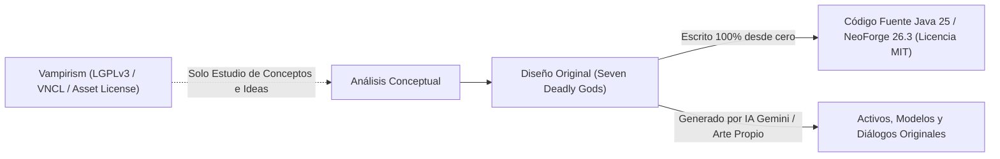

# ⚖️ Análisis Legal y de Licencia: Repositorio de Vampirism (TeamLapen)

Este documento detalla el marco legal y los términos de licencia del repositorio oficial **[TeamLapen/Vampirism](https://github.com/TeamLapen/Vampirism)**, explicando con precisión qué está permitido, qué está prohibido, bajo qué condiciones y cómo afecta al desarrollo de **Seven Deadly Gods** (licenciado bajo **MIT**).

---

## 1. La Arquitectura Multilicencia de Vampirism

A diferencia de los proyectos con una licencia monolítica, el repositorio de **TeamLapen/Vampirism** divide su propiedad intelectual en **cuatro categorías legales independientes**:

```
+---------------------------------------------------------------------------------------+
|                       ESTRUCTURA DE LICENCIAS DE VAMPIRISM                            |
+---------------------------------------------------------------------------------------+
|  1. Código Fuente Java / Configs / Data      ──> GNU LGPL v3.0 (Lesser General Public)|
|  2. Texturas, Sprites y Modelos 3D           ──> Vampirism Asset License              |
|  3. Lore, Libros, Diálogos y Textos          ──> Vampirism Narrative Content (VNCL)   |
|  4. Efectos de Audio y Sonidos               ──> Licencias Individuales de Terceros   |
+---------------------------------------------------------------------------------------+
```

---

## 2. Desglose por Componente

### 2.1 Código Fuente: GNU Lesser General Public License v3.0 (LGPLv3)
El código de lógica del juego (archivos `.java`, clases, estructuras de datos y utilidades) está protegido por **GNU LGPLv3**.

* **Naturaleza Legal**: Es una licencia de **código abierto con Copyleft Débil**.
* **Implicación Clave**:
  * Si un proyecto **enlaza dinámicamente** con una biblioteca LGPLv3 (por ejemplo, compilando contra ella como un archivo `.jar` externo en Maven/Gradle), el proyecto consumidor puede mantener una licencia diferente (como MIT o propietaria).
  * Sin embargo, si se **copia, pega o modifica directamente código fuente** de Vampirism dentro de otro proyecto, ese código se convierte legalmente en una **obra derivada** (*Derivative Work*). La cláusula Copyleft de la sección 4 de LGPLv3 / sección 5 de GPLv3 exige que **toda la obra derivada sea relicenciada obligatoriamente bajo LGPLv3 o GPLv3**.

> [!WARNING] Incompatibilidad con la Licencia MIT de Seven Deadly Gods
> Tu mod *Seven Deadly Gods* utiliza la licencia **MIT** (`mod_license=MIT` en `gradle.properties`). Si copias clases o algoritmos de Vampirism directamente en tus paquetes `com.volcov.sevendeadlygods.*`, estarías violando la licencia a menos que cambies la licencia de todo tu mod a **LGPLv3**, perdiendo la permisividad total de MIT.

---

### 2.2 Texturas y Modelos 3D: Vampirism Asset License
Todas las texturas (`.png`), modelos (`.json`, `.bbmodel`) e iconos visuales están sujetos a la **Vampirism Asset License**.

* **Condiciones**:
  * Solo otorga permiso para su uso en contenidos estrechamente vinculados a Vampirism (como add-ons oficiales o integraciones directas).
  * **Prohibición comercial**: Queda expresamente prohibido su uso en proyectos comerciales o con ánimo de lucro.
  * **Prohibición de extracción**: No está permitido extraer los sprites, texturas de altares, tótems, armas o colmillos para incluirlos en otros mods independientes o paquetes de texturas independientes (*standalone resource packs*).

---

### 2.3 Contenido Narrativo: Vampirism Narrative Content License (VNCL)
Abarca todo el material escrito: nombres de personajes, libros de lore in-game, descripciones de ítems, cartas y textos de ambientación.

* **Condiciones**:
  * Es una licencia propietaria de TeamLapen diseñada para proteger el universo ficticio de su mod.
  * **Prohibición total de copia**: No se pueden reproducir fragmentos de texto, mitología o diálogos en ningún otro proyecto sin consentimiento explícito por escrito del equipo autor.

---

### 2.4 Sonidos y Efectos de Audio
Los efectos de sonido (`.ogg`) incluidos en el mod no son enteramente de TeamLapen; provienen de diversas fuentes (Freesound, grabaciones propias, bibliotecas libres con atribución).

* Cada sonido cuenta con una licencia particular listada en su archivo `README.md`.
* La gran mayoría prohíbe la redistribución sin créditos específicos y enlaces a los autores originales, y varios tienen licencias *Non-Commercial* (CC BY-NC).

---

## 3. Semáforo Legal: ¿Qué se puede y qué no se puede hacer?

| Acción | Estado | Fundamento Legal y Condiciones |
| :--- | :---: | :--- |
| **Inspirarse en la idea mecánica** (aldeas con facciones, tótems/altares centrales, asedios territoriales, reputación) | ✅ **PERMITIDO** | **Las mecánicas de juego, ideas y conceptos no tienen copyright** (Convenio de Berna / WIPO). Solo la expresión tangible (el código escrito y el arte) está protegida. |
| **Escribir tu propio código desde cero** (*Clean-Room Implementation*) | ✅ **PERMITIDO** | Al programar tus propias clases (`GodVillageSavedData`, `GodVillageRaidManager`) usando las APIs públicas de Minecraft y NeoForge, tu código es 100% de tu autoría y conserva legítimamente la licencia **MIT**. |
| **Leer el repositorio público para aprender cómo interactúa con Minecraft** | ✅ **PERMITIDO** | El código es público para estudio e investigación. Comprender qué eventos utiliza o cómo estructura los datos es perfectamente legal siempre que no se copie el código. |
| **Utilizar `FactionAPI` como dependencia externa vía Gradle** | ⚠️ **CON CONDICIONES** | Permitido por LGPLv3 siempre que se use como dependencia binaria `.jar` externa sin alterar su código y se otorguen los créditos correspondientes. *(No recomendado para 26.3 debido a versiones incompatibles).* |
| **Copiar y pegar clases o métodos de Vampirism en tu proyecto** | ❌ **PROHIBIDO (bajo MIT)** | La cláusula Copyleft de LGPLv3 forzaría a que tu mod pase a ser LGPLv3. Si mantienes tu mod como MIT mientras contiene código LGPLv3 copiado, cometes una infracción de derechos de autor. |
| **Copiar texturas, modelos 3D o iconos del repositorio** | ❌ **PROHIBIDO** | La *Vampirism Asset License* prohíbe taxativamente la reutilización de sus activos visuales en mods independientes. |
| **Copiar textos, nombres de facciones o libros de lore** | ❌ **PROHIBIDO** | Protegido bajo la *VNCL* (Vampirism Narrative Content License). |
| **Extraer audios o efectos de sonido de su mod** | ❌ **PROHIBIDO** | Viola las licencias individuales y cláusulas no comerciales de los autores de audio. |

---

## 4. Estrategia Recomendada para Seven Deadly Gods

Para garantizar que tu mod sea **100% legal, ético y completamente libre de restricciones de copyleft**, la metodología adoptada en nuestra arquitectura es la **Ingeniería de Sala Limpia (*Clean-Room Design*)**:



### Reglas de Oro para el Desarrollo:
1. **Código 100% Original**: Todos los archivos Java de `com.volcov.sevendeadlygods.village.*` se desarrollan desde cero utilizando las herramientas nativas de **NeoForge 26.3** (`SavedData`, `ServerLevel`, `MerchantOffers`, `StructureTemplatePool`).
2. **Identidad Propia**: En lugar de "Vampiros y Cazadores", tus facciones son los **7 Pecados Capitales** con deidades conscientes (Mammon, Khorvath, Lucian, etc.), cada una con su sistema asimétrico de favor y avatares.
3. **Arte y Modelado Único**:
   * Los bloques de altar (`SinAltarBlock`) y los modelos de acólitos alados (`GodAcolyteModel`, `GodAcolyteRenderer`) son activos propios de tu mod.
   * Los textos sagrados provienen de `SinLoreLibrary` y del generador en tiempo real de **Google Gemini**, sin reutilizar ningún contenido literario de terceros.
4. **Preservación de la Licencia MIT**:
   * Al no incorporar ninguna línea de código protegida por LGPLv3, *Seven Deadly Gods* permanece como software libre bajo la **Licencia MIT**, permitiendo a cualquier jugador o creador de modpacks disfrutarlo, distribuirlo e integrarlo sin trabas legales.
