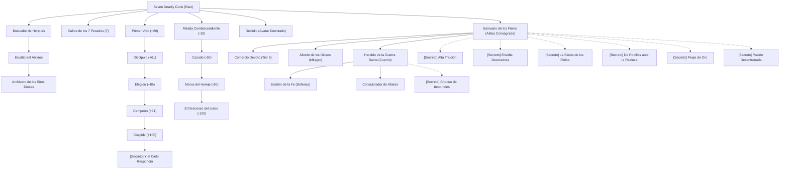

# 🏆 Árbol de Avances y Logros

**Seven Deadly Gods** incorpora una rama de avances completa accesible desde el menú de logros de Minecraft (`L`).

---

## 🌳 Estructura de la Rama de Avances

### 1. Avance Raíz
* **«Seven Deadly Gods»**: Los Siete Pecados Capitales observan en silencio el destino del mundo. *(Se desbloquea al entrar al mundo)*.

### 2. Desbloqueo de Cultos y Altares (Lectura de Lore)
* **«Culto a Mammon»**: Descifra los textos sagrados y aprende a forjar el Altar de la Avaricia.
* **«Culto a Khorvath»**: Descifra los textos sagrados y aprende a forjar el Altar de la Ira.
* **«Culto a Beelze»**: Descifra los textos sagrados y aprende a forjar el Altar de la Gula.
* **«Culto a Lucian»**: Descifra los textos sagrados y aprende a forjar el Altar de la Soberbia.
* **«Culto a Leviatán»**: Descifra los textos sagrados y aprende a forjar el Altar de la Envidia.
* **«Culto a Belphegor»**: Descifra los textos sagrados y aprende a forjar el Altar de la Pereza.
* **«Culto a Asmodeus»**: Descifra los textos sagrados y aprende a forjar el Altar de la Lujuria.

### 3. Coleccionismo de Escrituras
* **«Buscador de Herejías»**: Encuentra y descifra 10 textos sagrados de los Pecados Capitales.
* **«Erudito del Abismo»**: Reúne 25 libros sagrados leídos.
* **«Archivero de los Siete Dioses»**: Descifra al menos 40 de los 49 tomos sagrados del panteón.

### 4. La Escala de la Gracia Divina (+Favor)
* **«Primer Voto»**: Gana la simpatía inicial de una deidad (`+20 Favor`).
* **«Discípulo de los Rituales»**: Alcanza el rango de Discípulo (`+61 Favor`) y domina los ritos de bendición.
* **«Escoltado por el Cielo»**: Conságrate como Elegido (`+85 Favor`). Los Acólitos alados volarán a defenderte.
* **«Campeón Divino»**: Conviértete en Campeón (`+91 Favor`) y goza de salvación milagrosa ante la muerte.
* **«Cúspide de la Devoción»**: Alcanza la comunión suprema (`+100 Favor`) y recibe la Reliquia Sagrada en el altar.

### 5. La Escala de la Ira Divina (-Favor)
* **«Mirada Condescendiente»**: Despierta el disgusto de una deidad (`-20 Favor`).
* **«Cazado por el Panteón»**: Alcanza `-60 Favor`. Los Enviados han sido despachados para castigarte.
* **«Marca del Hereje»**: Sé declarado hereje (`-80 Favor`). Los Acólitos celestiales descienden a darte caza.
* **«El Descenso del Juicio»**: Colma la paciencia divina (`-100 Favor`) y desata la cólera del Avatar en persona.

### 6. Aldeas Consagradas y Guerras Santas (Normales)
* **«Santuario de los Fieles» (`village_discovery`)**: Adéntrate en una aldea consagrada a uno de los Siete Pecados Capitales. *(Padre: Raíz)*.
* **«Comercio Devoto» (`divine_trade_master`)**: Desbloquea las ofrendas supremas al comerciar con un Acólito Centinela (`Favor >= 60`). *(Padre: Santuario de los Fieles)*.
* **«Heraldo de la Guerra Santa» (`divine_war_horn_use`)**: Haz resonar el Cuerno de Guerra Divino para declarar una incursión contra un templo rival. *(Padre: Santuario de los Fieles)*.
* **«Bastión de la Fe» (`defend_shrine_victory`)**: Repele una incursión sagrada y defiende con éxito el santuario consagrado de tu deidad. *(Padre: Heraldo de la Guerra Santa)*.
* **«Conquistador de Altares» (`temple_conquest`)**: Destruye o reconsagra un templo rival durante una Guerra Santa. *(Padre: Heraldo de la Guerra Santa)*.
* **«Aliento de los Dioses» (`village_miracle_restore`)**: Revitaliza una aldea arrasada obrando un milagro en el altar con un Tótem de la Inmortalidad y una Manzana Dorada. *(Padre: Santuario de los Fieles)*.
* **«Deicidio» (`slay_god_avatar`)**: Derrota en combate a una manifestación física de un Avatar divino. *(Padre: Raíz)*.

---

## 🔮 Logros Secretos y Ocultos

Los logros secretos no revelan su título ni descripción hasta que el jugador descubre o detona la interacción especial en el mundo:

1. **«Y el Cielo Respondió» (`secret_god_answered_call`)**: Tus plegarias rompieron el firmamento: una deidad descendió físicamente ante tu llamado verbal en el chat (`Favor = 100`).
2. **«Alta Traición» (`secret_high_treason`)**: Ataca a los aldeanos o el altar de tu propio dios con devoción positiva, sufriendo una condena inmediata por herejía (`-60 Favor`).
3. **«Choque de Inmortales» (`secret_clash_of_the_gods`)**: Presencia cómo dos Avatares divinos descienden a enfrentarse entre sí en la misma guerra santa (15% en manifestación durante raid).
4. **«Envidia Devoradora» (`secret_ruined_envy_village`)**: Visita una aldea arrasada y reducida a ruinas por la amarga envidia de Leviatán.
5. **«La Siesta de los Fieles» (`secret_sloth_society`)**: Alcanza la quietud suprema durmiendo o permaneciendo 30 segundos inmóvil junto al letárgico rebaño de Belphegor.
6. **«De Rodillas ante la Realeza» (`secret_pride_humiliation`)**: Inclínate de rodillas (`Shift`) ante los aristócratas de Lucian para que se dignen a abrir comercio contigo sin ser Discípulo.
7. **«Peaje de Oro» (`secret_greed_tax_paid`)**: Paga un tributo en pepitas de oro simplemente por abrir un cofre de almacenamiento en los dominios de Mammon.
8. **«Pasión Desenfrenada» (`secret_lust_wild_passion`)**: Sé testigo presencial de la fertilidad desatada contagiando a los animales en el santuario de Asmodeus.

---

## 🗺️ Diagrama del Árbol de Avances

